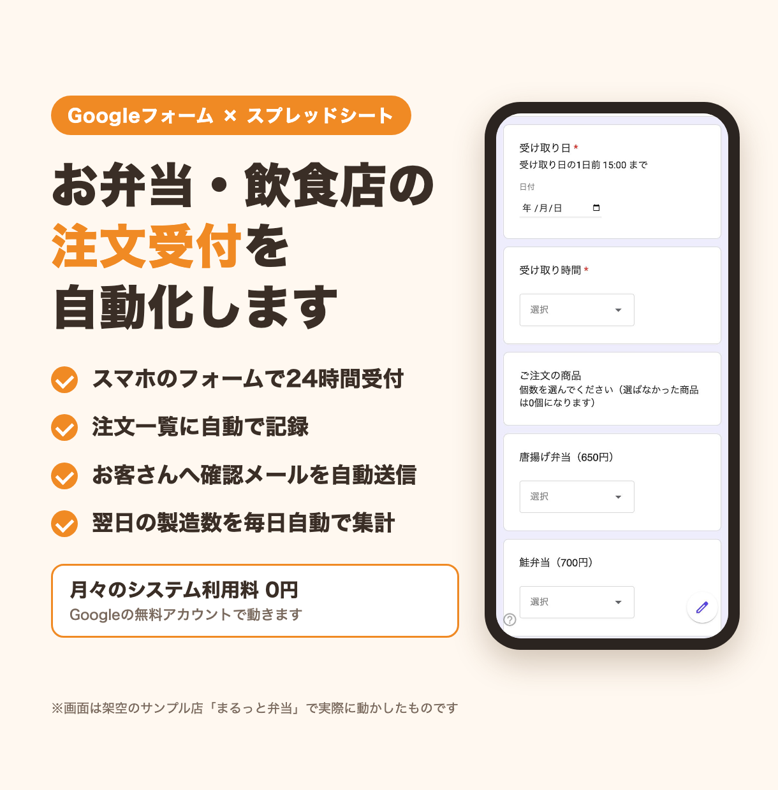
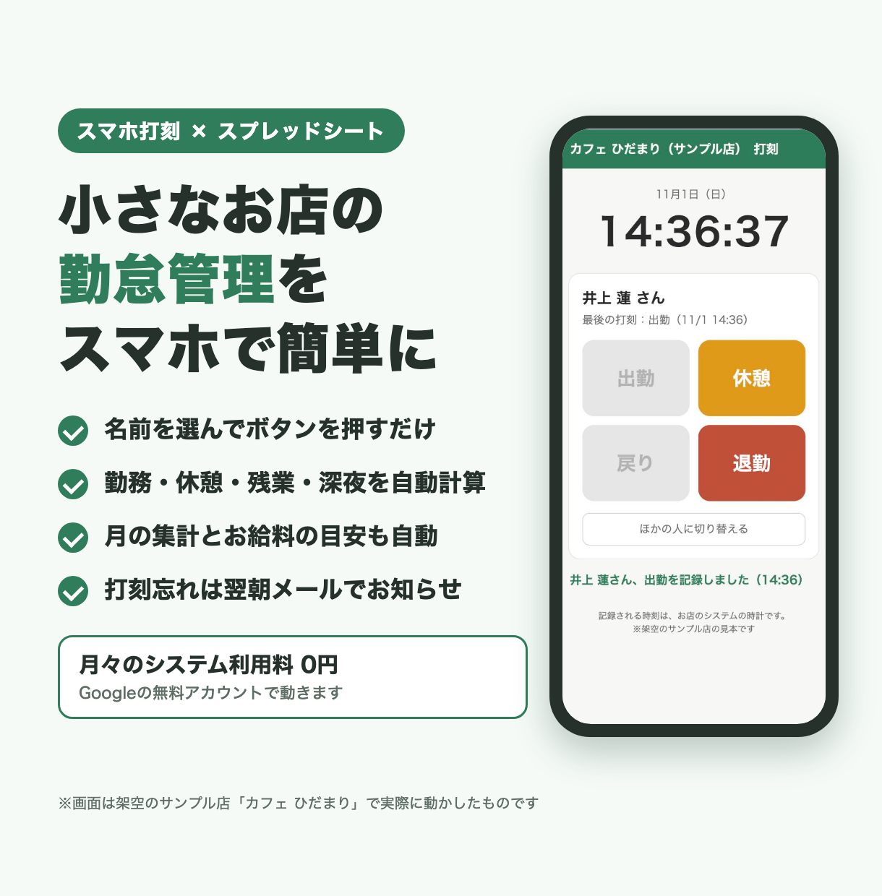
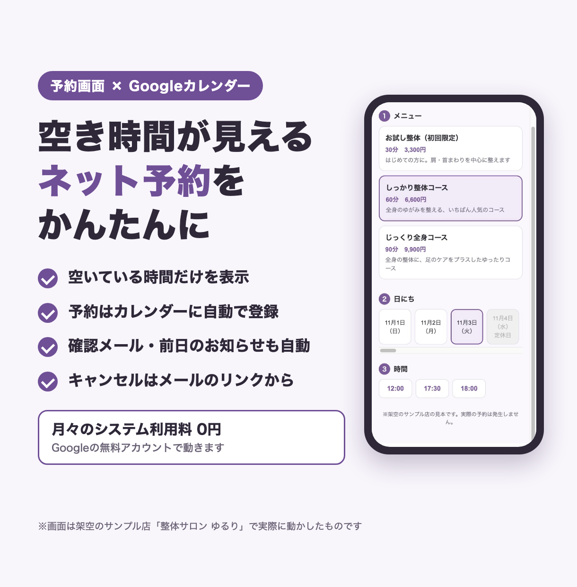
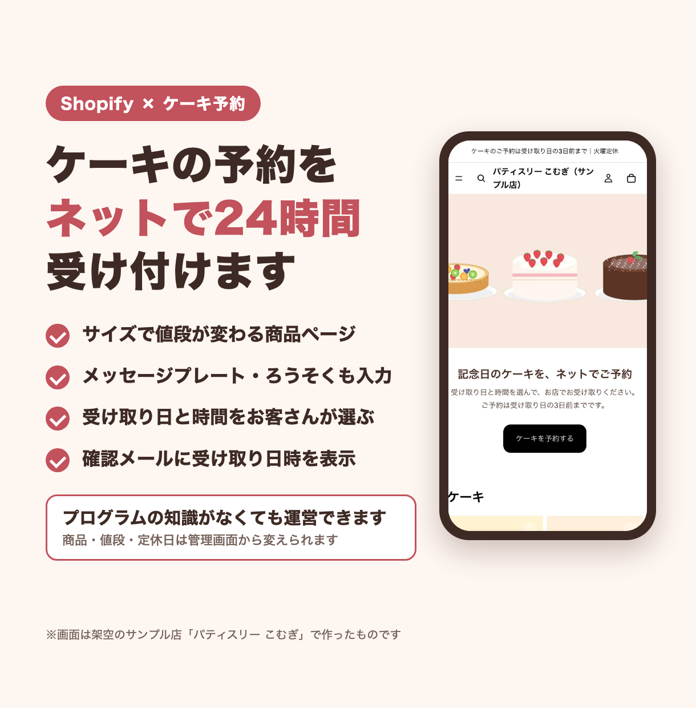
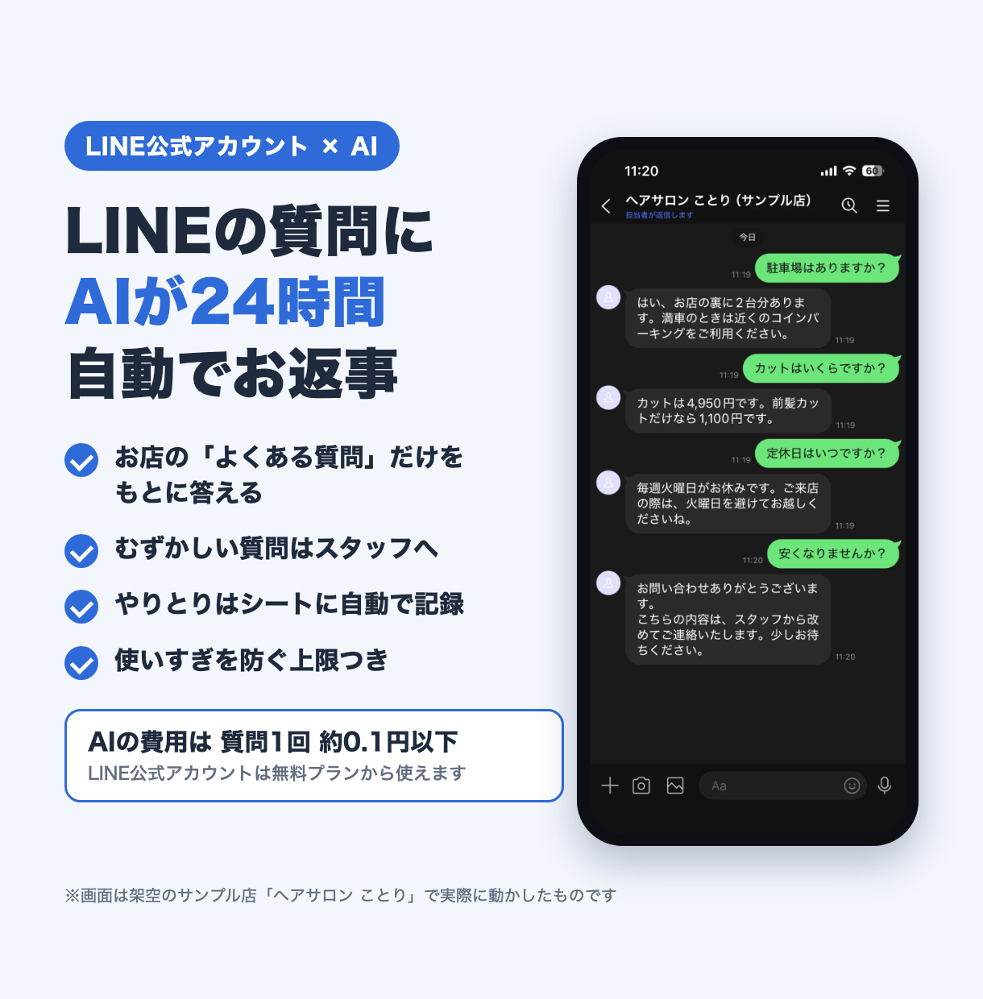
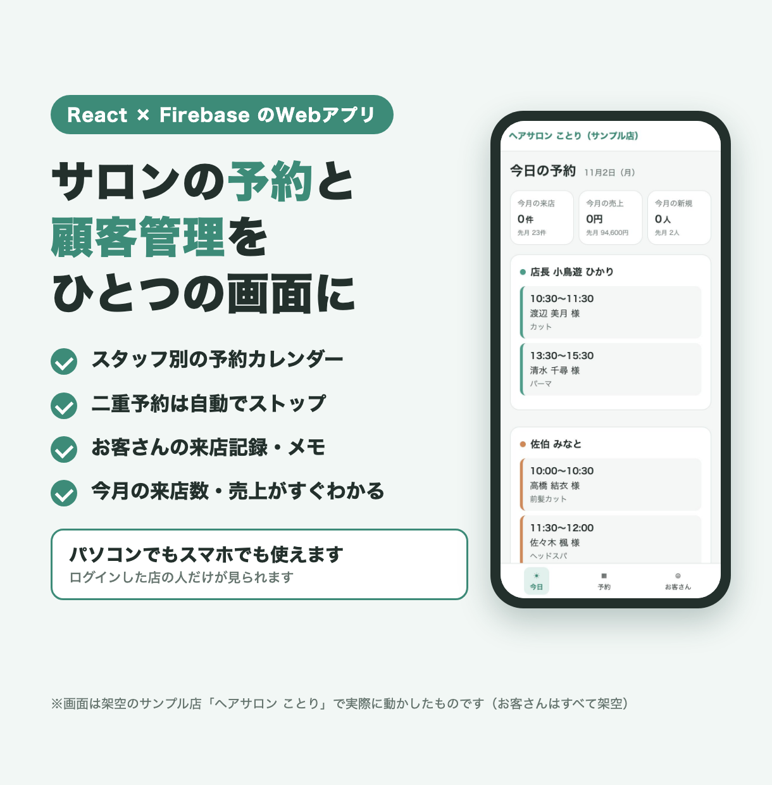

# shop-automation-samples

お店や小さな会社の「毎日の手作業」を自動化する仕組みの**見本集**です。
注文の受付・勤怠・予約・ネットショップ・LINE のお返事・顧客管理の6つを、実際に動く形で作りました。

> ここに出てくるお店・スタッフ・お客さん・注文・予約・売上は、**すべて架空のもの**です。実在のお店や人とは関係ありません。
> メールアドレスは `example.com` などの見本用のもの、電話番号は `090-0000-0000` のような見本の形にしています。

## 見本の一覧

| No | 見本名 | 業種 | できること | 使った技術 | フォルダ |
|---|---|---|---|---|---|
| 1 | 注文受付の自動化（まるっと弁当） | お弁当・飲食店 | フォームの注文を自動で記録し、確認メールと翌日の製造数の集計まで自動で行う | Google Apps Script・Googleフォーム・スプレッドシート・Gmail | [01-bento-order](samples/01-bento-order/) |
| 2 | 勤怠管理（カフェ ひだまり） | カフェ・小さなお店 | スマホで打刻し、勤務・残業・深夜の計算と月の集計、打刻忘れのお知らせまで行う | Google Apps Script（Webアプリ）・スプレッドシート・HTML/CSS/JavaScript | [02-attendance](samples/02-attendance/) |
| 3 | 予約管理（整体サロン ゆるり） | 整体・サロン | 空き時間だけを見せるネット予約。カレンダー登録・確認メール・前日のお知らせ・キャンセルまで自動 | Google Apps Script（Webアプリ）・Googleカレンダー・スプレッドシート・Gmail | [03-reservation](samples/03-reservation/) |
| 4 | ケーキ予約のネットショップ（パティスリー こむぎ） | 洋菓子店 | サイズ・メッセージプレートを選び、受け取り日時を指定して予約できるネットショップ | Shopify（オンラインストア 2.0）・Liquid・JavaScript・Python | [04-shopify-cake](samples/04-shopify-cake/) |
| 5 | LINE×AI 自動応答（ヘアサロン ことり） | 美容室 | LINE の質問に、お店の「よくある質問」だけを根拠に AI が返事し、むずかしい質問はスタッフへ引きつぐ | LINE Messaging API・Claude API・Google Apps Script・スプレッドシート | [05-line-ai](samples/05-line-ai/) |
| 6 | 予約・顧客管理Webアプリ（ヘアサロン ことり） | 美容室・サロン | スタッフ別の予約カレンダー・二重予約の防止・顧客台帳・来店の記録・今月の数字をひとつの画面に | React・TypeScript（Vite）・Firebase（Firestore・Authentication） | [06-salon-admin](samples/06-salon-admin/) |

くわしい機能・フォルダ構成・設置の手順は、それぞれのフォルダの `README.md` と `設置手順書.md` にあります。

## 見本ごとの紹介

### 1. 注文受付の自動化 ― まるっと弁当

[](samples/01-bento-order/)

Googleフォームで受けたお弁当の注文を、スプレッドシートに注文番号つきで記録します。締め切り後・定休日・1日の上限をこえた注文は自動で「受付不可」にし、お客さんへの確認メールとお店への通知を送ります。毎日決まった時刻に、翌日の製造数（商品別・受け取り時間別・アレルギーやご要望の一覧）をまとめてメールで届けます。

→ [01-bento-order](samples/01-bento-order/)

### 2. 勤怠管理 ― カフェ ひだまり

[](samples/02-attendance/)

スマホの画面で名前を選び、4けたの暗証番号を入れて「出勤・休憩・戻り・退勤」を押すだけの勤怠管理です。時刻は Google 側の時計で記録します。日ごとの勤務時間・休憩・残業・深夜と、月の集計（お給料の目安つき）を自動で作り、毎朝、打刻の足りない日をメールで知らせます。暗証番号を続けてまちがえるとロックします。

→ [02-attendance](samples/02-attendance/)

### 3. 予約管理 ― 整体サロン ゆるり

[](samples/03-reservation/)

営業時間・休憩・定休日・入っている予約・お店の私用の予定をよけて、予約できる時間だけを表示するネット予約です。予約が入ると Googleカレンダーに登録し、確定の直前にもう一度空きを確かめてダブルブッキングを防ぎます。確認メール・前日のお知らせ・メールのリンクからのキャンセルにも対応しています。

→ [03-reservation](samples/03-reservation/)

### 4. ケーキ予約のネットショップ ― パティスリー こむぎ

[](samples/04-shopify-cake/)

Shopify の無料テーマ「Horizon」をもとにした、ケーキを予約して店頭で受け取るネットショップです。サイズで値段が変わる商品ページ、メッセージプレート・ろうそくの入力、カートでの受け取り日時の指定（近すぎる日・先すぎる日・定休日は選べない）、注文確認メールへの受け取り日時の表示ができます。商品・ページ・メニューなどのストアの中身は、Python のスクリプト1本で作れます。

Horizon テーマ本体は、Shopify の利用条件によりこのリポジトリには入れていません。見本4には、自分で足したファイルと、テーマのどこをどう変えたかの説明だけを置いています。

→ [04-shopify-cake](samples/04-shopify-cake/)

### 5. LINE×AI 自動応答 ― ヘアサロン ことり

[](samples/05-line-ai/)

LINE 公式アカウントに届いた質問に、AI（Claude）が自動でお返事します。答えの根拠は、お店がスプレッドシートに書いた「よくある質問」だけです。値引き・体のこと・予約の空き・クレーム・シートに無い質問には AI が答えず、スタッフへ引きついでお店にメールで知らせます。会話はすべてシートに残り、使いすぎを防ぐ回数の上限もあります。

表紙の LINE の画面は、架空のお店の LINE 公式アカウントで実際に動かしたものです。

→ [05-line-ai](samples/05-line-ai/)

### 6. 予約・顧客管理Webアプリ ― ヘアサロン ことり

[](samples/06-salon-admin/)

美容室・サロン向けに、予約と顧客管理をひとつにまとめた管理画面です。スタッフ別の予約カレンダー（1日・週）、同じスタッフで時間が重なる予約を保存させない二重予約の防止、ふりがな・電話番号で探せる顧客台帳、来店の記録、今月の来店数・売上・新規の人数を表示します。ログインした店の人だけが読み書きできるよう、Firestore のルールで守っています。パソコンでもスマホでも使えます。

→ [06-salon-admin](samples/06-salon-admin/)

## 共通の作りの工夫

- **コードを触らずに設定を変えられる**
  - Google Apps Script の見本（1・2・3・5）は、店名・締め切り・定休日・上限数・営業時間などを「設定」シートから読みます。お店の人はシートを書きかえるだけで動きを変えられます。
  - ネットショップ（4）は、予約できる日数・定休日・受け取り時間を Shopify のテーマ設定から変えられます。
- **計算と画面・外部サービスを分けて、テストできる形に**
  - Google Apps Script の見本は、受付の判定・勤務時間・空き時間・AI の返事の読み取りなどの計算を `Logic.gs` にまとめ、スプレッドシートやメールなどの Google のサービスを使わない形にしています。
  - Webアプリ（6）は、時間・重なり・検索・集計の計算を `src/lib/` に分け、それぞれにテストを付けています。
- **デモモードのメール**：注文受付（1）と予約管理（3）は、試しているあいだはお客さん宛てのメールもお店の通知先に届き、本文に本来の宛先を書き添えます。知らない人にメールが送られる心配がありません。「設定」シートで `OFF` にすると本番の動きになります。
- **自動テスト**：Google Apps Script の見本は、Google のサービスをまねた「にせもの」の部品を用意し、Googleアカウントなしでパソコン上で「初期設定 → 受付 → 集計」などの流れを通しで確かめます。Webアプリ（6）は、練習用の Firebase（エミュレーター）でアクセスの決まりとデータの読み書きもテストします。
- **安全のための工夫**
  - 入力された文字がスプレッドシートの式として動かないよう、`=` などで始まる文字には先頭に `'` を付けて記録します（1・2・3・5）。
  - 同時に処理が走ったときの二重記録を `LockService` で防ぎます（1・2・3・5）。
  - APIキーや LINE のトークンはシートやリポジトリに書かず、スクリプトの中に保存します（5）。

## テストの動かし方

それぞれのフォルダに入ってから動かします。

| 見本 | 必要なもの | コマンド | テストの数 |
|---|---|---|---|
| 1 注文受付 | Node.js 18 以上（追加のインストール不要） | `node --test tests/*.test.js` | 33件 |
| 2 勤怠管理 | Node.js 18 以上（追加のインストール不要） | `node --test tests/*.test.js` | 36件 |
| 3 予約管理 | Node.js 18 以上（追加のインストール不要） | `node --test tests/*.test.js` | 32件 |
| 4 ネットショップ | Python 3 | `python3 -m py_compile setup_store.py images/make.py images/make_hero.py`（文法の確認のみ。自動テストはありません） | ― |
| 5 LINE×AI | Node.js 20 以上（追加のインストール不要） | `node --test tests/*.test.js` | 33件 |
| 6 予約・顧客管理 | Node.js 22.12 以上・npm（エミュレーターのテストには Java 21 以上も） | `npm ci` のあと `npm test`、`npm run test:emu` | 28件＋8件 |

例：

```bash
cd samples/01-bento-order
node --test tests/*.test.js
```

本物の Google・LINE・Claude・Firebase にはつながりません。

## 注意

- すべて架空のお店のための見本です。設置の流れは、各フォルダの `設置手順書.md` で見られます。
- APIキー・トークン・スプレッドシートの ID・本番の Firebase の設定は、リポジトリに入っていません。
- ネットショップ（4）は Shopify の「Horizon」テーマをもとにしていますが、テーマ本体は Shopify の利用条件によりリポジトリに入れていません。見本4には、自分で作ったファイルと、テーマへの変更点の説明だけを入れています。

## コードの利用について

この見本集は、制作実績の紹介のために公開しています。コードの利用・改変・再配布はご遠慮ください（Shopify・Firebase などの外部のライブラリやサービスは、それぞれの利用条件にしたがいます）。

## ご依頼・ご相談

この見本をもとにした仕組みづくりのご依頼・ご相談は、ココナラ・クラウドワークス・ランサーズのプロフィールからお願いします。
