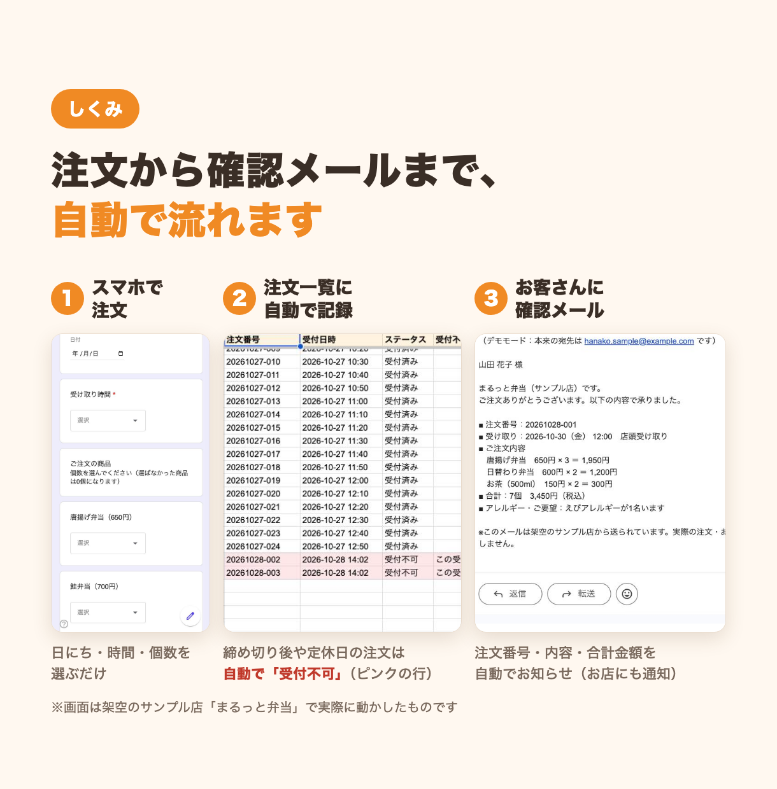
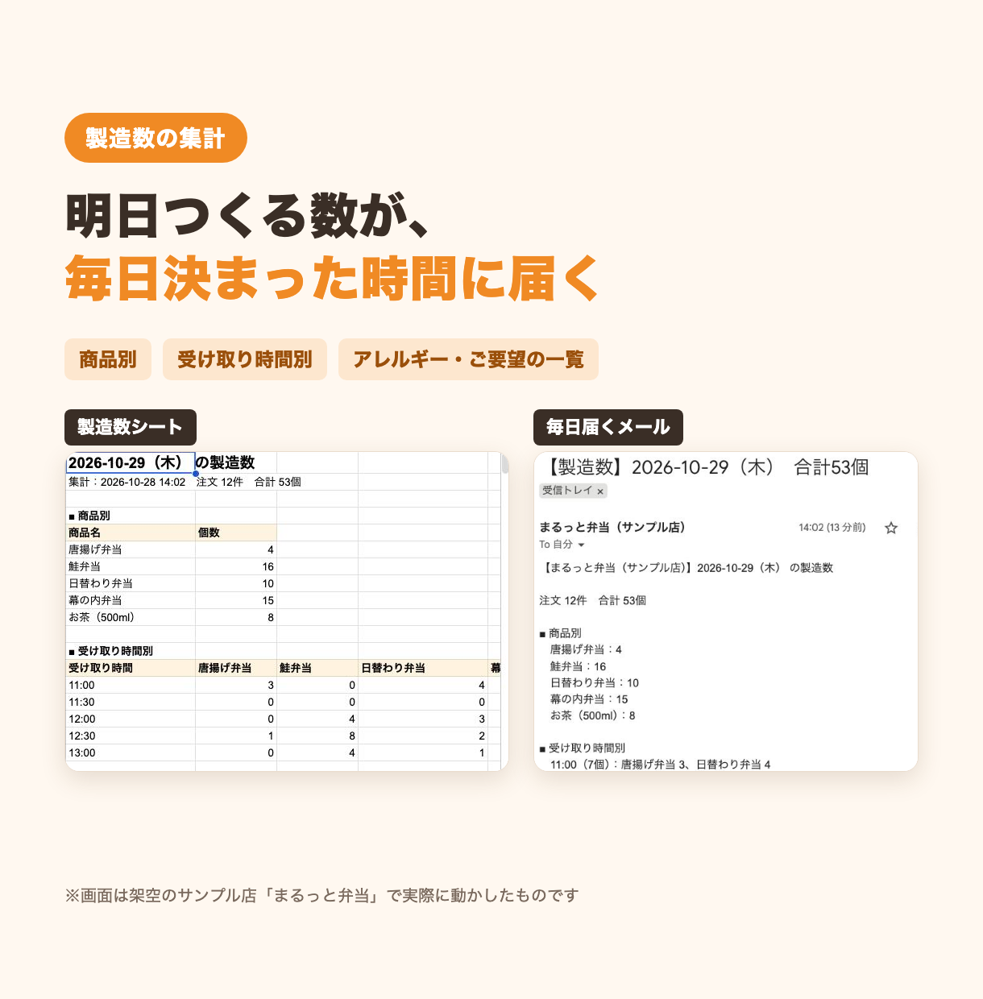

# 注文受付の自動化 ― 架空のお弁当屋さん「まるっと弁当」の見本

> これは、架空のサンプル店「まるっと弁当」を使って作った**見本**です。実在のお店・お客さんとは関係ありません。

Googleフォームで受けたお弁当の注文を、スプレッドシートに自動で記録し、確認メールの送信や翌日の製造数の集計までを自動で行う仕組みです。
電話・FAXで受けて手で書き写し、前日に個数を数えていた作業を、Googleの無料アカウントだけで置きかえることを想定しています。

## できること

- **スマホのフォームで24時間受付**：受け取り日・時間・受け取り方法・商品ごとの個数を選ぶだけ
- **注文一覧に自動で記録**：注文番号を付けて1注文1行で記録。フォームに入力された文字は、スプレッドシートの式として動かないように記録します
- **受付不可の自動判定**：締め切り後・定休日・1日の上限を超えた注文・個数が多すぎる注文などは、自動で「受付不可」にしてピンク色の行にします（理由も記録）
- **確認メールの自動送信**：お客さんには注文番号・内容・合計金額のメール、お店には新着の通知メール
- **翌日の製造数を毎日自動で集計**：決まった時刻に「商品別」「受け取り時間別」「アレルギー・ご要望の一覧」をシートにまとめ、メールでも届けます
- **コードを触らずに設定を変えられる**：締め切り・定休日・上限数・受け取り時間・メニューと値段は、シートを書きかえるだけ
- **デモモード**：試しているあいだは、お客さん宛てのメールもお店にだけ届くので、知らない人にメールが送られる心配がありません

## 画面

| 注文フォーム（スマホ） | しくみの流れ |
|---|---|
|  |  |



ほかの画面（フォーム・注文一覧・製造数シート・確認メール・設定シートなど）の切り抜きは [screens/shots](screens/shots) にあります。

## 使った技術

- Google Apps Script（V8ランタイム）
- Googleフォーム（スクリプトから自動で作成・更新）
- Googleスプレッドシート（注文一覧・製造数・メニュー・設定・ログ）
- Gmail（MailApp でのメール送信。1日の送信上限が近いときは、お店宛ての通知を優先）
- 時間主導型トリガー（毎日の製造数集計）
- テスト：Node.js の標準テストランナー（`node --test`）と、GAS を真似た「にせもの」の部品

## フォルダ構成

```
01-bento-order/
├── README.md          この説明
├── 設置手順書.md        自分のGoogleアカウントに設置する手順
├── src/               Apps Script のコード（そのまま貼る・clasp push できる）
│   ├── Logic.gs       計算・判定だけの部分（受付可否・合計・集計・メール文面）
│   ├── Common.gs      共通部品（設定シート・ログ・シート準備・デモモード付きメール送信）
│   ├── Order.gs       フォームが送信されたときの処理
│   ├── Daily.gs       毎日の製造数の集計
│   ├── Setup.gs       メニュー・初期設定・フォームの作成と更新
│   ├── Sample.gs      架空のお客さんの見本データを入れる
│   └── appsscript.json  マニフェスト（タイムゾーン：Asia/Tokyo）
├── tests/
│   ├── loadGas.js     .gs を Node.js で読み込み、GAS のにせものを用意する
│   ├── logic.test.js  計算・判定のテスト
│   └── flow.test.js   初期設定 → 注文 → 集計 の通しのテスト
├── screens/shots/     実際に動かしたときの画面の切り抜き
└── listing/           紹介用の画像
```

## テストの動かし方

Node.js 18 以上があれば、追加のインストールなしで動きます（Google のアカウントは要りません）。

```sh
cd samples/01-bento-order
node --test tests/*.test.js
```

`logic.test.js` は受付の判定・合計・集計・メール文面などの計算を、`flow.test.js` は GAS のにせものの上で「初期設定 → 注文 → 受付不可の判定 → 製造数の集計 → リセット」までを通しで確かめます。

## 設置の流れ

自分のGoogleアカウントで動かすときは、[設置手順書.md](設置手順書.md) を見てください。おおまかには次の流れで、15分くらいです。

1. 新しいスプレッドシートを作る
2. 「拡張機能」→「Apps Script」に `src` のファイルを貼る
3. メニュー「🍱 サンプル店」→「初期設定（最初に1回）」を押す（フォーム・シート・毎日のトリガーが自動でできます）
4. フォームから試しに注文して、注文一覧とメールを確かめる

## 注意

- お店の名前「まるっと弁当」、メニュー、お客さんの名前・メールアドレス・電話番号は、すべて**架空のもの**です（メールアドレスは `example.com`、電話番号は `090-0000-0000` のような見本の形にしています）。
- 画面の画像は、見本用のGoogleアカウントで実際に動かしたものです。
- 本番のお店で使うときは、設定シートの「デモモード」を `OFF` にするまで、お客さんにはメールが届きません。
