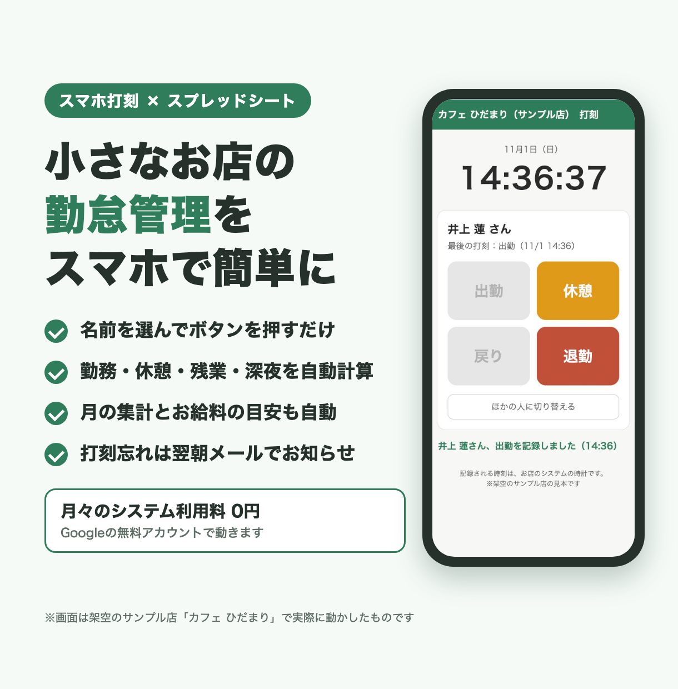
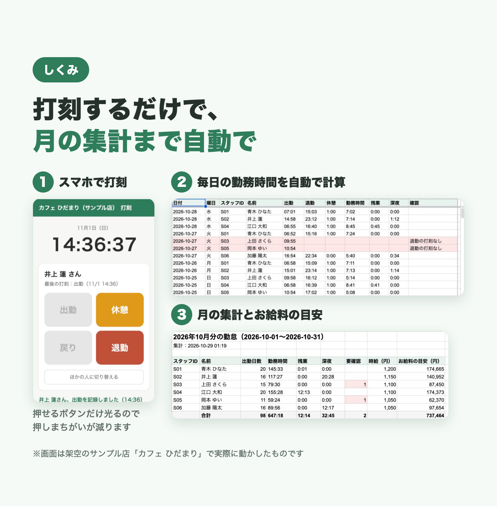
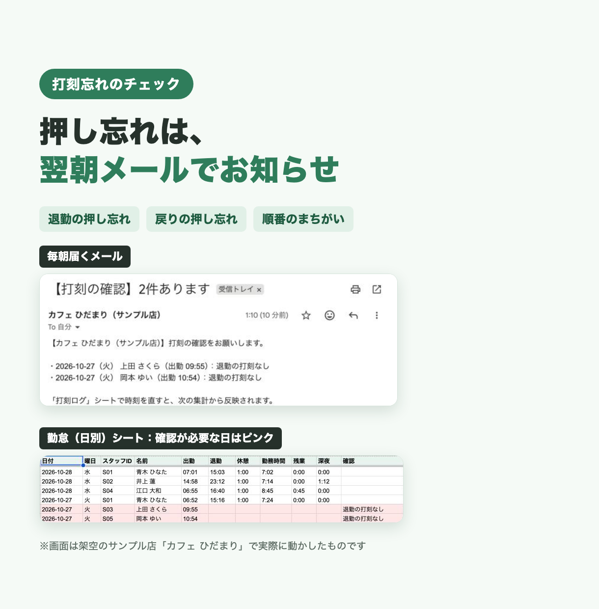

# 勤怠管理の見本（架空のお店「カフェ ひだまり」）

小さなお店向けの、スマホで打刻できる勤怠管理です。
Google スプレッドシートと Google Apps Script（GAS）だけで動きます。

> ここに出てくるお店「カフェ ひだまり（サンプル店）」とスタッフ・打刻のデータは、すべて架空のものです。

## できること
- **スマホで打刻**：名前を選び、4けたの暗証番号を入れて「出勤・休憩・戻り・退勤」を押すだけ。その時に押せるボタンだけが光るので、押しまちがいが減ります
- **時刻はGoogle側の時計で記録**：スマホの時計をずらしても打刻の時刻は変わりません
- **勤務時間の自動計算**：日ごとの勤務時間・休憩・残業・深夜（22時〜5時など）を計算します
- **月の集計**：スタッフ別の出勤日数・勤務時間・残業・深夜と、お給料の目安（時給×時間＋割増）をまとめます。締め日は月末・15日・20日などに変えられます
- **打刻忘れのお知らせ**：毎朝、過去7日の打刻の足りない日（退勤の押し忘れなど）を調べてメールします。確認が必要な日はシートでピンクになります
- **設定はシートで**：店名・締め日・時給・暗証番号・残業や深夜の区切り・チェックの時刻は、シートを書きかえるだけで変えられます
- **いたずら対策**：暗証番号を5回まちがえると10分間ロックし、お店にメールで知らせます。集計やリセットなどの操作は打刻画面からは呼べません

## 画面

| スマホの打刻画面 | 打刻から月の集計まで | 打刻忘れのお知らせ |
|---|---|---|
|  |  |  |

ほかの画面の切り抜きは [screens/shots](screens/shots) にあります。

## 使った技術
- Google Apps Script（V8）
  - スプレッドシートのメニュー・時間のトリガー（毎朝のチェック）
  - Webアプリ（`doGet` と HTML Service）で打刻画面を表示
  - `LockService`（同時に押されたときの二重記録を防ぐ）、メール送信
- Google スプレッドシート（設定・スタッフ・打刻ログ・日別・月の集計）
- HTML / CSS / JavaScript（スマホ向けの打刻画面）
- Node.js の標準テスト（`node --test`）：GAS の機能をまねる部品を用意し、パソコン上で計算と流れを確かめます
- clasp（コードをGASへ送る道具）

## フォルダ構成
```
02-attendance/
├── README.md          … この説明
├── 設置手順書.md       … 設置の手順
├── src/               … GAS のコード（clasp でそのまま送る）
│   ├── appsscript.json … GAS の設定（タイムゾーン・Webアプリ）
│   ├── Setup.gs       … 初期設定・メニュー・トリガー
│   ├── Punch.gs       … 打刻画面（Webアプリ）と、暗証番号の確認・打刻の記録
│   ├── Index.html     … 打刻画面（スマホ表示）
│   ├── Logic.gs       … 勤務時間・残業・深夜・お給料の目安の計算（GASの機能を使わない）
│   ├── Attendance.gs  … 打刻ログから日別の勤怠と月の集計を作る
│   ├── Daily.gs       … 毎朝の打刻忘れチェックとメール
│   ├── Sample.gs      … 見本の打刻データを入れる
│   └── Common.gs      … 設定シート・ログ・メール送信などの共通部品
├── tests/             … パソコンで動かすテスト
│   ├── loadGas.js     … .gs を Node.js で読み込む仕組みと、GAS のにせもの
│   ├── logic.test.js  … 計算のテスト
│   └── flow.test.js   … 初期設定 → 打刻 → 集計 → 打刻忘れチェックの通しのテスト
├── listing/           … 紹介用の画像
└── screens/shots/     … 実際に動かした画面の切り抜き
```

## テストの動かし方
Node.js 18 以上があれば、追加のインストールなしで動きます。

```bash
cd samples/02-attendance
node --test tests/*.test.js
```

Node.js 26 で、logic.test.js は 15件、flow.test.js は 21件、すべて通ることを確かめています。

## 設置の流れ
1. clasp でスプレッドシートとGASを作り、`src` のコードを送る
2. メニューの「初期設定（最初に1回）」でシートと毎朝のトリガーを用意する
3. 打刻画面をWebアプリとして公開する
4. 「サンプルの打刻を入れる」で見本のデータを入れて、動きを確かめる

くわしくは [設置手順書.md](設置手順書.md) を見てください。

## 注意
- お店の名前・スタッフの名前・時給・暗証番号・打刻のデータは、すべて見本用の架空のものです
- 見本の暗証番号（1234 など）は、実際に使うときは必ず変えてください
- お給料の目安は、時給×時間に残業・深夜の割増を足しただけのものです。交通費や控除は入っていません。実際のお給料の計算や労務の判断は、お店のルールと法律にそって確かめてください
