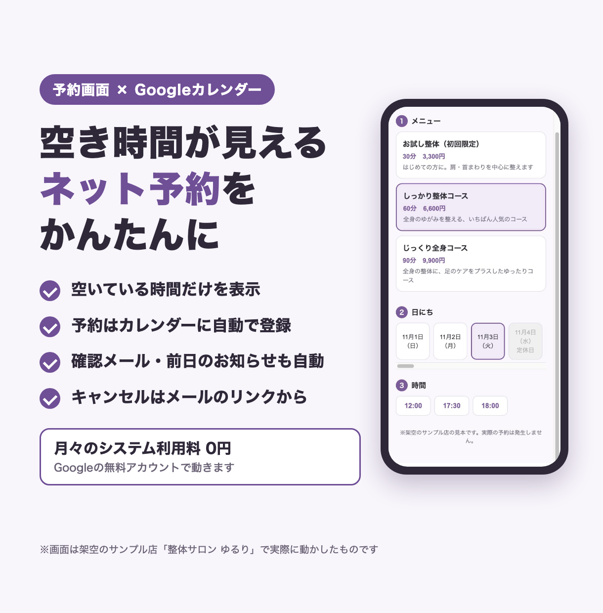
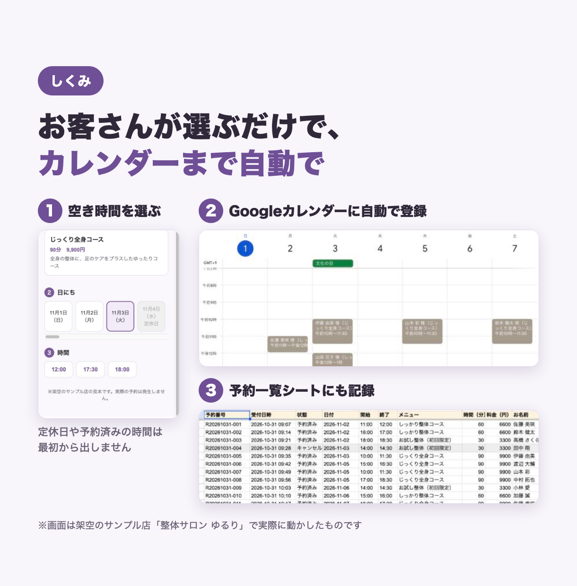
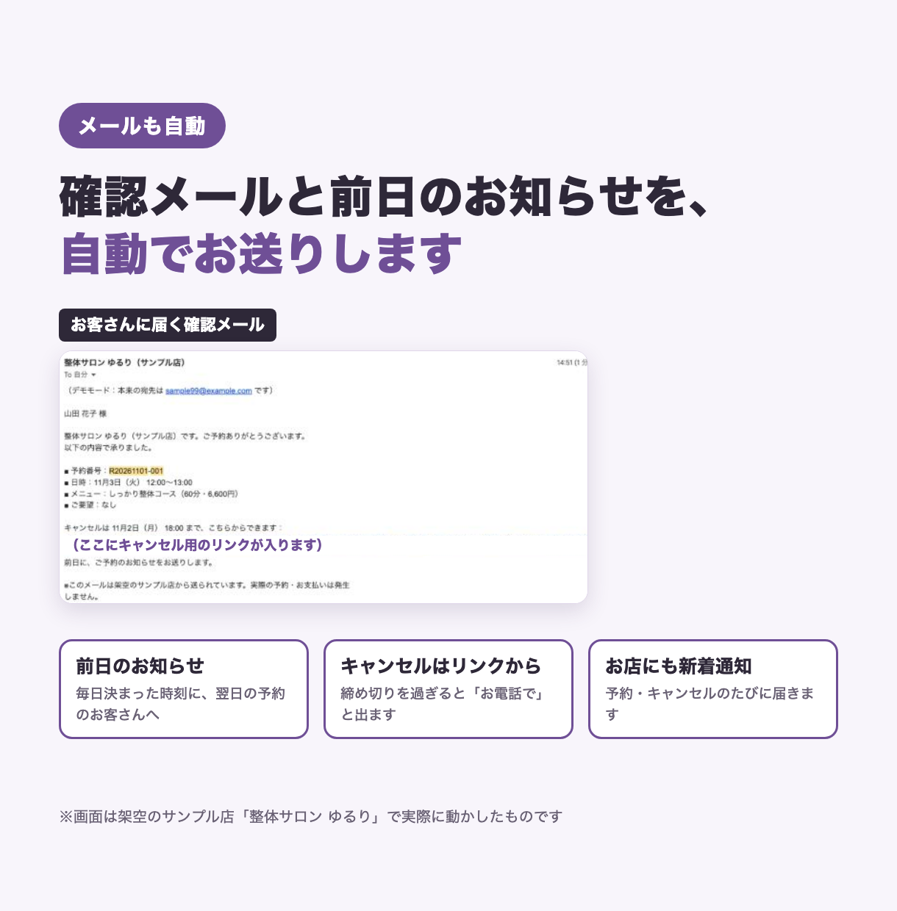
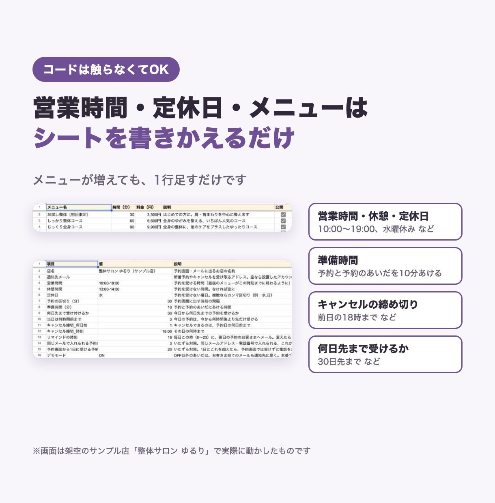

# 予約管理の見本 ― 架空のお店「整体サロン ゆるり」

> このフォルダは、架空のサンプル店「整体サロン ゆるり」を例にした **見本** です。実在のお店ではありません。

お客さまがスマホで空いている時間を選んで予約すると、Googleカレンダーへの登録、確認メール、前日のお知らせまでを自動で行う、ネット予約のしくみです。Googleスプレッドシートと Google Apps Script（GAS）だけで動きます。

## できること

- **空いている時間だけを表示**：営業時間・休憩・定休日・すでに入っている予約・店長の私用の予定をよけて、予約できる時間だけを出します
- **Googleカレンダーに自動で登録**：予約が入ると、お店の予約用カレンダーに予定ができます。予約一覧シートにも記録します
- **ダブルブッキングを防ぐ**：予約を確定する直前に、もう一度空きを確かめます
- **確認メール・前日のお知らせ**：予約したときに確認メール、前日の決まった時刻にお知らせメールを送ります。お店にも新着通知と「明日の予約一覧」が届きます
- **メールのリンクからキャンセル**：締め切り（最初は前日18時）を過ぎると「お電話で」と案内します
- **コードを触らずに変えられる**：営業時間・定休日・準備時間・キャンセルの締め切りは「設定」シート、メニューは「メニュー」シートを書きかえるだけです
- **いたずら対策**：同じメールアドレス・電話番号で入れられる予約の数や、1日に予約画面から受ける数に上限を設けられます
- **デモモード**：試しているあいだは、お客さま宛てのメールもお店の通知先に届きます

## 画面

| 予約画面とカレンダー | 予約の流れ |
|---|---|
|  |  |

| 確認メール | 設定シート |
|---|---|
|  |  |

画面の元の写真は `screens/shots/` にあります（予約画面・カレンダー・確認メール・各シート）。

## 使った技術

- Google Apps Script（V8）：Webアプリ（予約画面・キャンセル画面）、時間で動くトリガー（前日のお知らせ）
- Googleスプレッドシート：予約一覧・メニュー・設定・ログ
- Googleカレンダー（CalendarApp）：空き時間の確認と予約の登録
- Gmail（MailApp）：確認・お知らせ・キャンセルのメール
- HTML / CSS / JavaScript：スマホ向けの予約画面
- Node.js の標準テスト（`node --test`）：GAS の機能をにせものに置きかえて、パソコン上でテスト
- clasp：パソコンから Apps Script へコードを送る道具

## フォルダ構成

```
03-reservation/
├── README.md          この説明
├── 設置手順書.md        設置のしかた
├── src/               Apps Script に送るコード
│   ├── appsscript.json  設定（タイムゾーン・Webアプリの公開範囲）
│   ├── Common.gs        共通部品（設定シート・ログ・メール送信・デモモード）
│   ├── Logic.gs         空き時間・締め切り・入力チェックなどの計算（GASに頼らないのでテストしやすい）
│   ├── Reservation.gs   予約画面の処理・カレンダー連携・予約とキャンセル
│   ├── Reminder.gs      前日のお知らせ
│   ├── Setup.gs         初期設定・メニュー・トリガー登録
│   ├── Sample.gs        見本用の架空の予約を入れる
│   ├── Index.html       予約画面
│   └── Cancel.html      キャンセル画面
├── tests/
│   ├── loadGas.js       .gs を Node.js で読み込む仕組みと、GAS のにせもの
│   ├── logic.test.js    計算部分のテスト
│   └── flow.test.js     初期設定 → 予約 → キャンセル → 前日のお知らせ の通しのテスト
├── listing/           紹介用の画像
└── screens/shots/     実際に動かした画面の写真
```

## テストの動かし方

Node.js 18 以上があれば、追加のインストールなしで動きます。

```bash
cd samples/03-reservation
node --test tests/*.test.js
```

Googleのサービス（スプレッドシート・カレンダー・メール）はテスト用のにせものに置きかえているので、Googleアカウントがなくても試せます。

## 設置の流れ

1. clasp でスプレッドシートとスクリプトを作り、`src/` のコードを送る
2. メニュー「📅 サンプル店」→「初期設定（最初に1回）」で、シート・予約用カレンダー・毎日のトリガーを用意する
3. Webアプリとして公開し、予約画面のURLをホームページやSNSに貼る
4. 「設定」シートと「メニュー」シートをお店に合わせて書きかえ、デモモードを `OFF` にする

くわしくは [設置手順書.md](設置手順書.md) を見てください。

## 注意

- 「整体サロン ゆるり」は架空のお店です。画面やシートに出てくるお客さまの名前・電話番号・メールアドレス（`example.com`）もすべて架空のものです
- 見本の予約画面には「架空のサンプル店の見本です。実際の予約は発生しません。」と表示しています
- 確認メールの写真では、予約画面のURL（デプロイID）とキャンセル用のキーを伏せています
- 実際のお店で使うときは、デモモードを `OFF` にする前に、通知先メールや営業時間などの設定を必ず確かめてください
