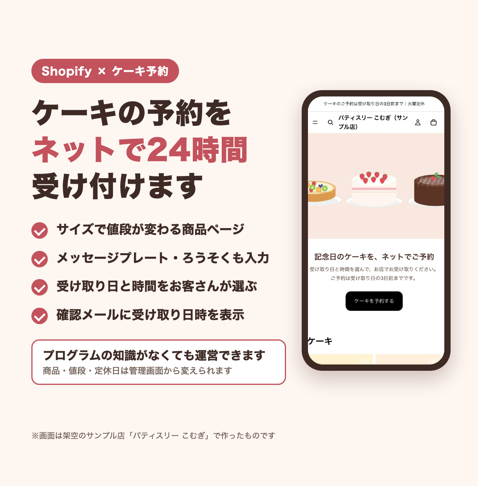
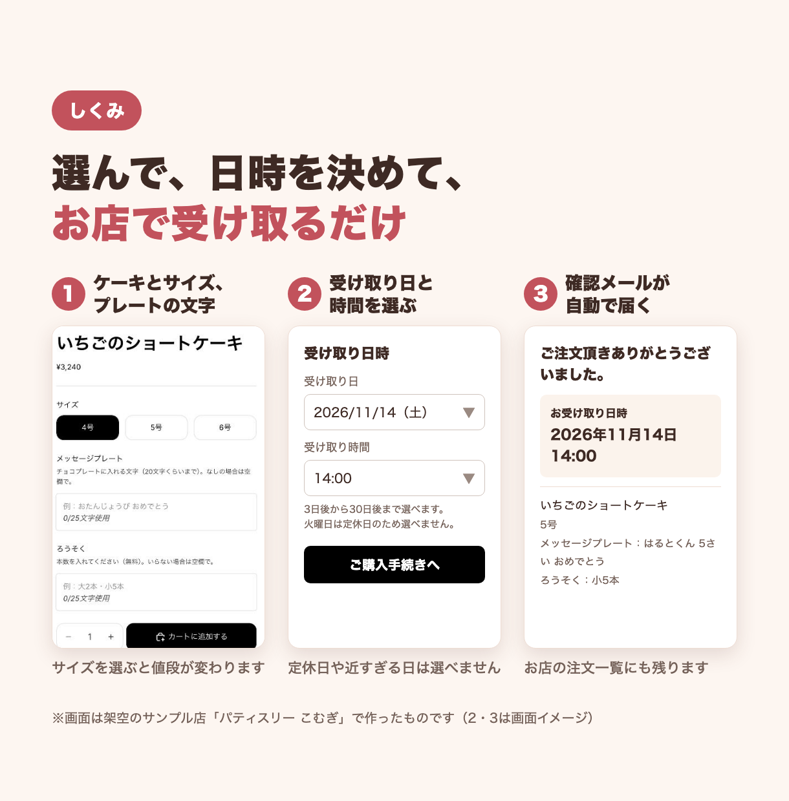
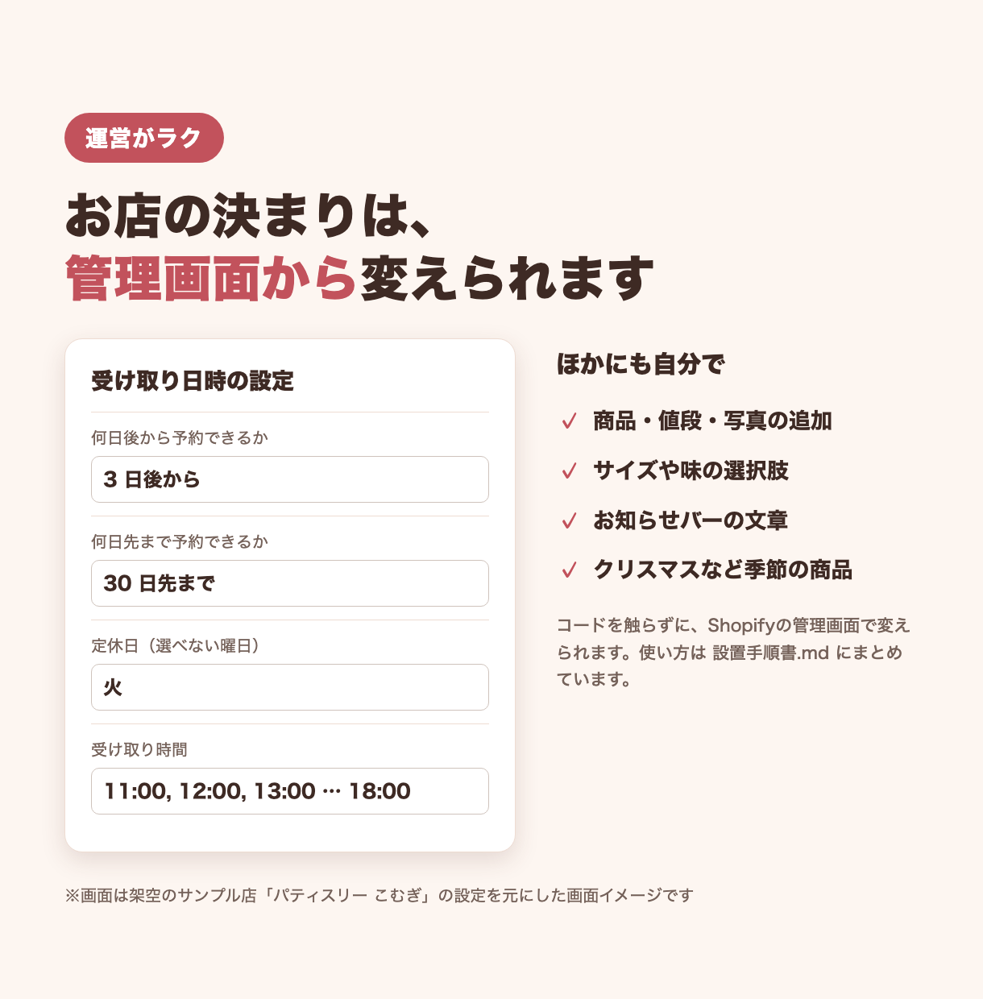

# ケーキ予約のネットショップ（架空のお店「パティスリー こむぎ」の見本）

Shopify で作った、ケーキを予約して店頭で受け取るネットショップの見本です。
お店・商品・住所・お客さんはすべて架空で、実在のお店とは関係ありません。

## できること
- **サイズで値段が変わる商品ページ**：ケーキは 4号・5号・6号から選べて、選ぶと値段が変わります
- **メッセージプレート・ろうそくの入力**：商品ページで入れた文字や本数が、注文の明細に残ります
- **カートで受け取り日時を選ぶ**：受け取り日と時間を選んでもらいます。近すぎる日（3日後より前）・先すぎる日・定休日は選べません
- **店頭受け取り**：送料なしの店頭受け取りにします
- **確認メールに受け取り日時**：注文確認メールに「お受け取り日時」を表示します。お店の注文画面にも残ります
- **管理画面から変えられる**：予約できる日数・定休日・受け取り時間・説明文は、テーマの設定から変えられます（コードを触る必要はありません）
- **ストアの中身を自動で作る**：商品・コレクション・ご利用ガイド・メニュー・店頭受け取りを、スクリプト1本で作れます

## 画面

| トップ・商品ページ | 予約から確認メールまでの流れ |
|---|---|
|  |  |



## 使った技術
- Shopify（オンラインストア 2.0）
- テーマ：Shopify の無料テーマ「Horizon」（v4.3.0）に、自分で作った部品を足して使っています（Liquid・JavaScript・CSS）
  - 受け取り日時の入力：`custom/snippets/pickup-datetime.liquid`（カートの属性として注文に保存）
  - 設定項目「受け取り日時」：`custom/config/settings_schema-pickup.json`
  - メッセージプレート・ろうそく：Horizon にある「特記事項」ブロックを、テーマエディタで商品ページに置いています
- 注文確認メール：Shopify の通知テンプレート（Liquid）
- ストアの準備：Python 3 ＋ Shopify CLI（`shopify store execute` で Admin GraphQL API を呼ぶ）
- 商品のイラスト：Python で SVG を作り、Chrome のヘッドレスモードで PNG に変換

## テーマ本体（Horizon）は入っていません
Horizon の利用条件では、Horizon をもとにしたテーマを Shopify の外で配ることが認められていません。
そのため、このフォルダには **Horizon のコードは入れていません**。入っているのは、自分で新しく作ったファイル（`custom/`）と、Horizon にどこを足したかの説明（下の「Horizon に加えた変更」）だけです。
Horizon は、Shopify の管理画面のテーマストアから無料で入れられます。手順は [設置手順書.md](設置手順書.md) にあります。

## フォルダ構成

```
04-shopify-cake/
├── README.md                 … この説明
├── 設置手順書.md              … 自分のストアに入れて動かす手順
├── setup_store.py            … 商品・コレクション・ページ・メニュー・店頭受け取り・看板画像を作るスクリプト
├── custom/                   … Horizon に足す、自分で作ったファイル
│   ├── snippets/
│   │   └── pickup-datetime.liquid      … カートの「受け取り日時」の入力（HTML・CSS・JavaScript）
│   ├── config/
│   │   └── settings_schema-pickup.json … テーマ設定「受け取り日時」の項目
│   └── theme-editor/
│       ├── intro.liquid                … トップページ「ごあいさつ」に貼る中身
│       └── order-steps.liquid          … トップページ「ご予約の流れ」に貼る中身
├── notifications/
│   └── order-confirmation-pickup.liquid … 注文確認メールに足す部分
├── images/
│   ├── make.py               … 商品のイラスト（7枚）を作る
│   ├── make_hero.py          … トップページの看板画像を作る
│   └── src/                  … イラストのもとになる HTML（make.py が書き出す）
├── screens/shots/            … 実際のストアの画面（スマホ。トップはテーマエディタのプレビュー）
└── listing/                  … 紹介用の画像と、そのもとの HTML（render.sh で PNG にする）
```

## Horizon に加えた変更
Horizon v4.3.0 と、実際に動かしたテーマを1ファイルずつ比べた結果です。
Horizon のファイルに手を入れたのは、次の2か所だけです。ほかのコード（Liquid・JavaScript・CSS・翻訳）は Horizon のままです。

### 1. `snippets/cart-summary.liquid`：受け取り日時の入力を出す（1行）
カートの合計金額（小計・税の注意書き）のブロックが終わったあと、「チェックアウト」ボタンを囲む `<div class="cart__ctas">` のすぐ上に、次の1行を足します。
カートのページと、カートの引き出し（ドロワー）の両方に出ます。

```liquid

```

呼び出される `snippets/pickup-datetime.liquid` は、`custom/snippets/` のファイルをそのまま入れます。

### 2. `config/settings_schema.json`：テーマ設定に「受け取り日時」を足す
ファイル全体は `[ … ]` の配列です。その最後の要素（「バリエーションピッカー」のグループ）のうしろにカンマを打ち、`custom/config/settings_schema-pickup.json` の中身を1つの要素として足します。
足すと、テーマエディタの「テーマ設定」に「受け取り日時」が出て、次の値を変えられるようになります。

| 設定 | 最初の値 |
|---|---|
| カートで受け取り日時を選んでもらう | オン |
| 何日後から予約できるか | 3日 |
| 何日先まで予約できるか | 30日 |
| 定休日（曜日。複数ならカンマ区切り） | 火 |
| 受け取り時間（カンマ区切り） | 11:00〜18:00 の1時間ごと |
| 説明文 | ケーキは3日後から予約できます。火曜日は定休日です。 |

### 3. テーマエディタで設定した内容
トップページの並びやお知らせバーなどは、コードではなくテーマエディタ（「オンラインストア」→「テーマ」→「カスタマイズ」）で設定しています。
画面の名前は、管理画面を日本語にしたときの表示です。

**トップページ（上から順に5つのセクション）**

| セクション | 設定した内容 |
|---|---|
| ヒーロー | 画像に、ファイルに上げた `hero.png`（看板画像）を選ぶ。最初から入っている見出しとボタンは削除。オーバーレイはオフ、上下の余白は 0 |
| カスタムLiquid（名前：ごあいさつ） | 新しく追加。「Liquidコード」に `custom/theme-editor/intro.liquid` を貼る。上下の余白 40 |
| 特集コレクション | コレクションを「ケーキ」、表示する数を 4、ボタンの文字を「すべて見る」 |
| カスタムLiquid（名前：ご予約の流れ） | 新しく追加。「Liquidコード」に `custom/theme-editor/order-steps.liquid` を貼る。背景色 #fbf3ec、上下の余白 48 |
| 特集コレクション | 新しく追加。コレクションを「焼き菓子」、表示する数を 4、ボタンの文字を「すべて見る」 |

**ヘッダー・フッター**

| 場所 | 設定した内容 |
|---|---|
| ヘッダー →「告知バー」のお知らせ | 文字を「ケーキのご予約は受け取り日の3日前まで｜火曜定休」 |
| フッター →「メールマガジン登録」の見出し | 「お知らせメール」 |
| フッター → 見出しの下の文 | 「季節の新作ケーキや、クリスマスケーキのご予約開始をお知らせします。」 |
| フッター →「メールマガジン登録」のボタン | 「登録する」 |

**商品ページ（ケーキ用のテンプレート「cake」）**

テンプレートの選択で「商品」→「テンプレートを作成」→ 名前を `cake`（もとは「デフォルトの商品」）にして作ります。`setup_store.py` で作るケーキ4点は、このテンプレートを使うように登録されます。

| 場所 | 設定した内容 |
|---|---|
| 商品情報 →「特記事項」ブロックを追加（1つ目） | 見出し「メッセージプレート」、説明「チョコプレートに入れる文字（20文字くらいまで）。なしの場合は空欄で。」、プロパティ名「メッセージプレート」、入力タイプ「テキスト」、最大文字数 25、入力は必須にしない、プレースホルダー「例：おたんじょうび おめでとう」 |
| 商品情報 →「特記事項」ブロックを追加（2つ目） | 見出し「ろうそく」、説明「本数を入れてください（無料）。いらない場合は空欄で。」、プロパティ名「ろうそく」、入力タイプ「テキスト」、最大文字数 25、入力は必須にしない、プレースホルダー「例：大2本・小5本」 |
| 2つのブロックの位置 | サイズを選ぶところ（バリエーション）のすぐ下、カートに入れるボタンの上 |
| 商品情報 →「価格」 | 「税情報」と「分割払い」の表示をオフ |

**テーマ設定**

| 場所 | 設定した内容 |
|---|---|
| カート →「簡単なチェックアウトボタン」 | オフ |
| 受け取り日時 | 上の表の最初の値のまま |

## テストの動かし方
この見本には自動テストはありません。Python のスクリプトに文法の誤りがないことは、次のコマンドで確かめられます。

```bash
cd samples/04-shopify-cake
python3 -m py_compile setup_store.py images/make.py images/make_hero.py
```

何も表示されなければ OK です。`python3 setup_store.py` を引数なしで動かすと、使い方が出て終わります（ストアには何もしません）。
テーマの動き（受け取り日時の入力・確認メール）は、[設置手順書.md](設置手順書.md) の「7. 動作を確認する」の手順で、開発用ストアで確かめます。

## 設置の流れ
1. テーマストアから Horizon を入れる
2. `custom/` のファイルを足し、上の「Horizon に加えた変更」の1・2の差し込みをする
3. テーマエディタで、トップページ・ヘッダー・フッター・ケーキ用テンプレートを設定する
4. `setup_store.py` で商品・ページ・メニュー・店頭受け取り・看板画像を作る（対象のストアは環境変数 `SHOPIFY_STORE` で指定）
5. 注文確認メールに受け取り日時の部分を足す

くわしくは [設置手順書.md](設置手順書.md) を見てください。

## 注意
- 「パティスリー こむぎ」は架空のお店です。商品・値段・住所（「サンプル町」）・注文の例などは、すべて見本用に作ったものです
- 画面は、Shopify の開発用ストア（本物の決済ができないストア）で作ったものです
- テーマ本体の Horizon は Shopify のもので、このリポジトリには入っていません。使うときは Shopify の利用条件に従ってください
