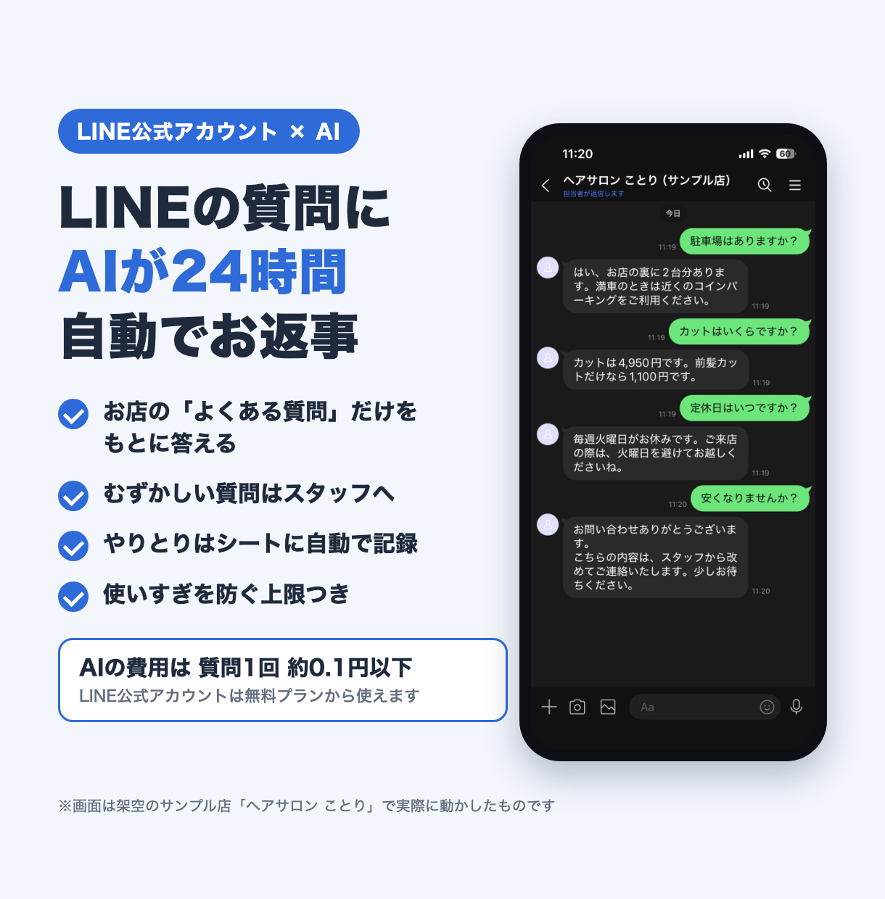
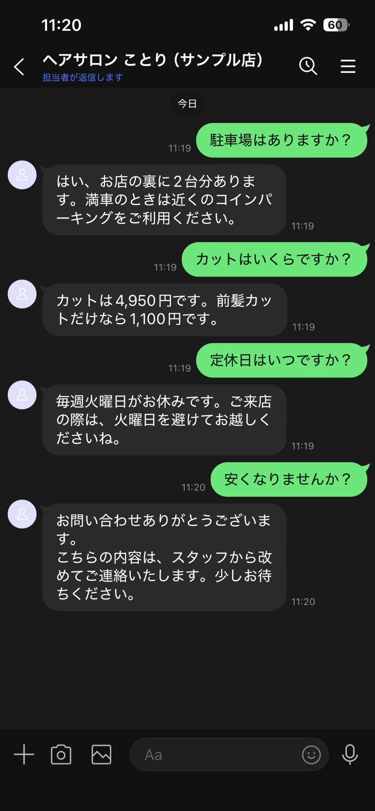
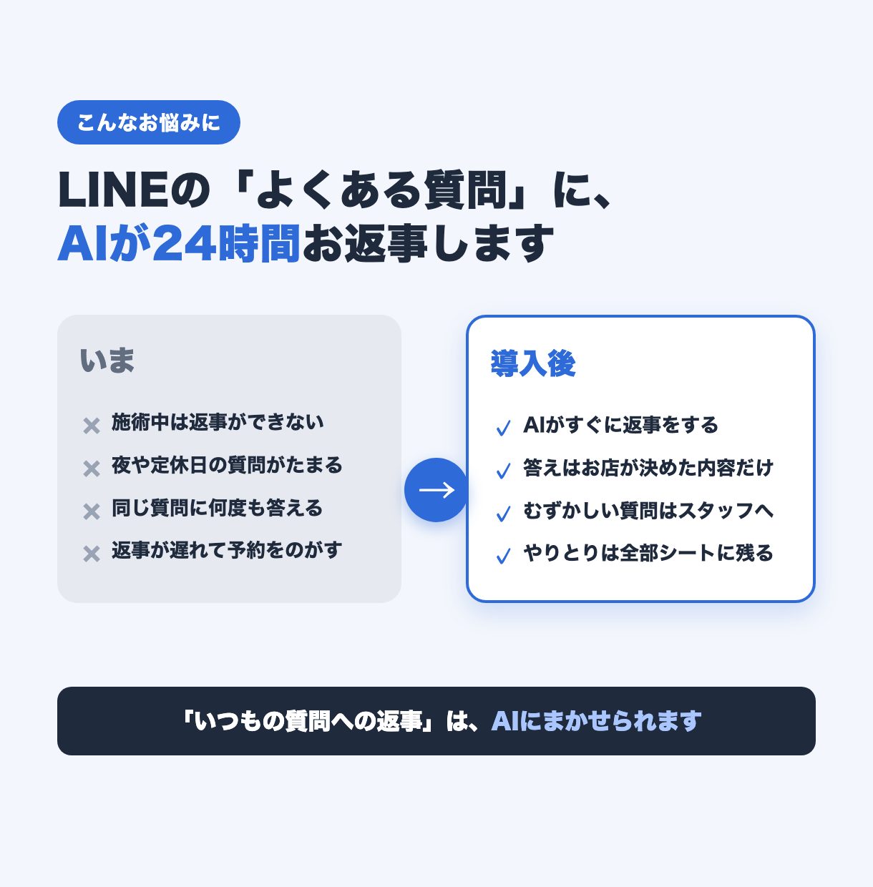
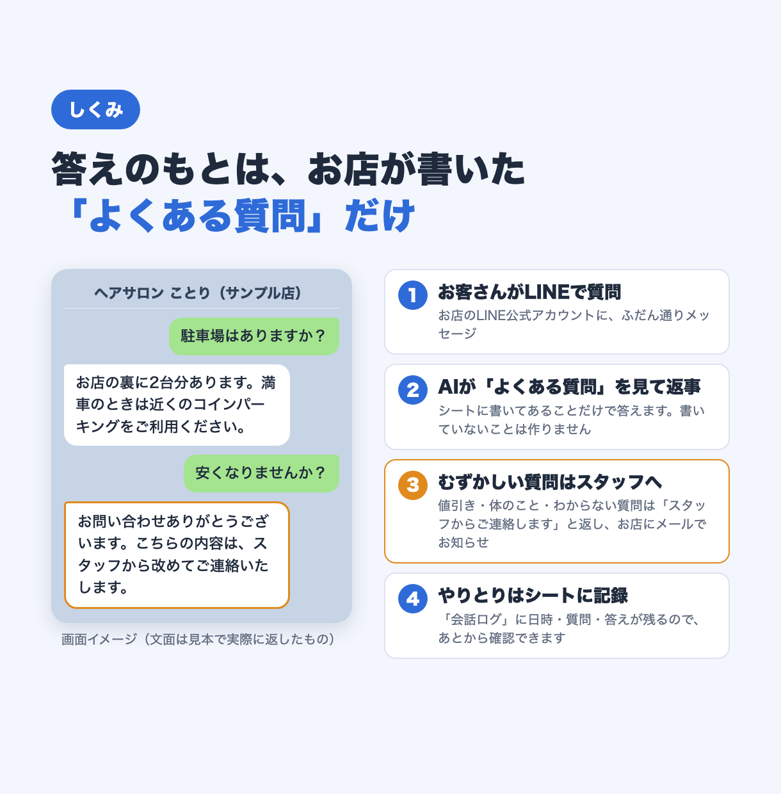
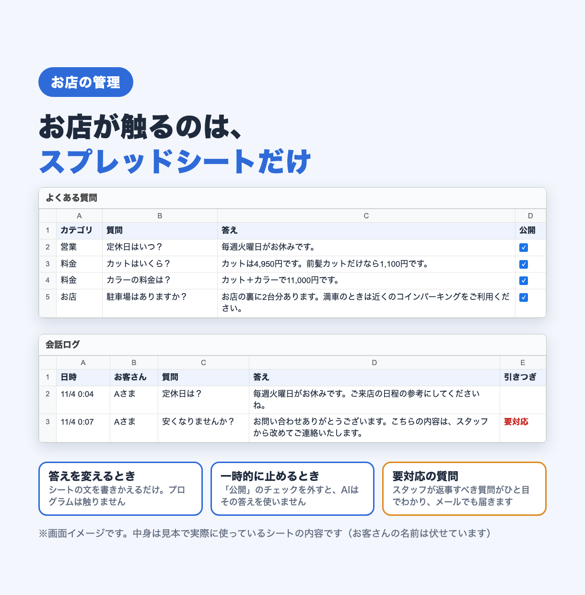
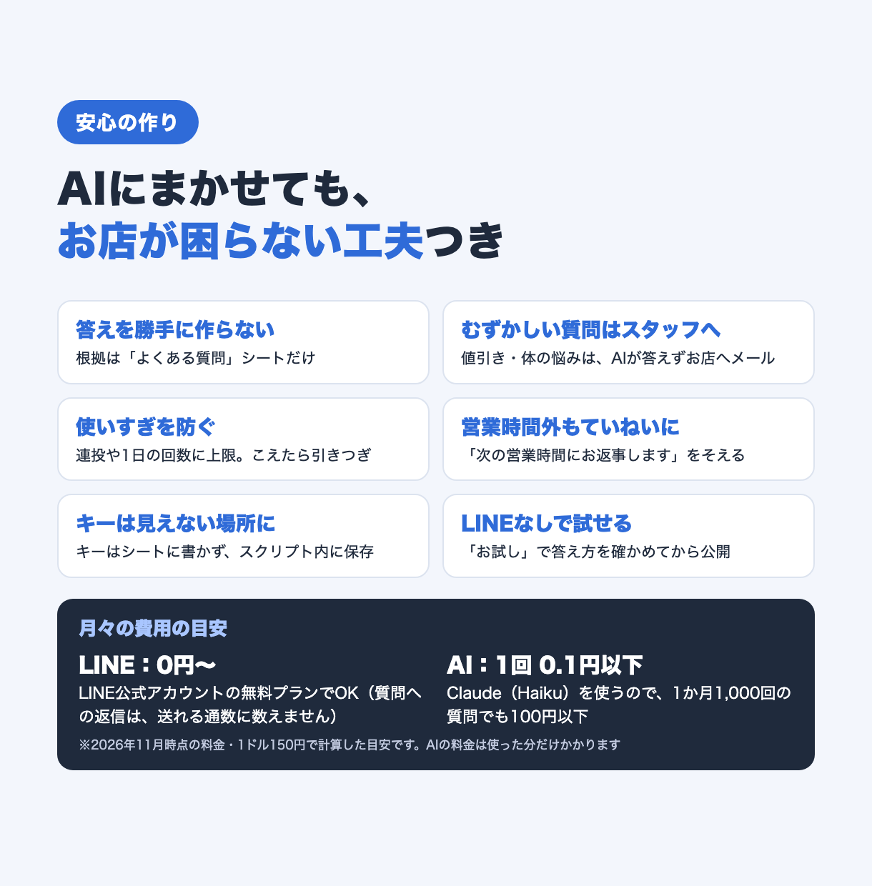

# LINE×AI 自動応答 ―「ヘアサロン ことり」（架空のお店）の見本

LINE 公式アカウントに届いた質問に、AI（Claude）が自動でお返事するしくみの見本です。
「ヘアサロン ことり」は、この見本のために作った**架空のお店**です。

AI が答えるのは、お店がスプレッドシートに書いた「よくある質問」の内容だけ。
値引きの相談や体のこと、シートに無い質問には AI は答えず、「スタッフからご連絡します」と返してお店にメールで知らせます。

## できること

- **LINE の質問に自動で返事**：営業時間・料金・駐車場など、いつもの質問に24時間すぐ答えます
- **答えの根拠は「よくある質問」シートだけ**：書いていないことは作りません。「公開」のチェックを外せば、その答えは使いません
- **スタッフへの引きつぎ**：割引・医療・予約の空き・クレーム・わからない質問は、AI が答えずにスタッフへ。お店にメールでお知らせします
- **営業時間外の一言**：時間外は「次の営業時間にお返事します」を添えます
- **会話ログ**：日時・お客さん・質問・答え・引きつぎの有無と理由をシートに残します
- **使いすぎ防止**：同じ人の連投（10分に5通まで）、1人1日20回、お店全体で1日200回までの上限（「設定」シートで変更可）。こえたらスタッフに引きつぎます
- **LINE なしでお試し**：メニューの「お試しで質問する」で、答え方をシート上で確かめてから公開できます
- **安全のための工夫**：APIキーと LINE のトークンはシートに書かずスクリプト内に保存／Webhook URL に秘密の文字列を付けて、それ以外の通知は無視／「=」で始まるメッセージを数式にしない／同じメッセージの再送は1回だけ処理／グループには答えない

## 画面

※表紙と LINE の画面は、架空のお店の LINE 公式アカウントで実際に動かしたものです（2026年11月）。ほかは説明用の図です。動作は、テスト33件と、実際の LINE とつないだ確認で確かめています。店名・質問・お客さんは架空のものです。

| 表紙 | LINE の画面（ふつうの質問 → 値引きの相談はスタッフへ） |
|---|---|
|  |  |

| 使う前と後 | しくみ |
|---|---|
|  |  |

| お店が触るのはスプレッドシートだけ | 安心の作り |
|---|---|
|  |  |

## 使った技術

- **LINE Messaging API**（Webhook で受け取り、返信 API で返事。表示名はプロフィール API）
- **Google Apps Script（GAS）**：ウェブアプリとして LINE の受け口に。メニュー・初期設定・メール通知も GAS
- **Google スプレッドシート**：設定・よくある質問・会話ログ・お試し・ログ
- **Claude API**（Anthropic）：初期値は `claude-haiku-5-5`。「よくある質問」だけを根拠に、答えか引きつぎかを JSON で返させています
- **Node.js の標準テスト（`node --test`）**：GAS の機能をまねた「にせもの」を使い、パソコン上でテストします（追加のインストールは不要）

## フォルダ構成

```
05-line-ai/
├── README.md          … この説明
├── 設置手順書.md       … 設置のくわしい手順・安全の工夫・気をつけること
├── listing/           … 紹介用の画像（表紙と説明用の図）
├── screens/           … 実際に動かしたときの LINE の画面
├── src/               … GAS のコード
│   ├── Line.gs        … LINE からの受け口（doPost）と、返事までの流れ・既定の設定
│   ├── Logic.gs       … AI への決まりづくり・返事の読み取り・営業時間・連投の判定など
│   ├── Api.gs         … Claude API と LINE API の呼び出し
│   ├── Setup.gs       … メニュー・初期設定・キーの設定・お試し・Webhook URL の表示
│   ├── Sample.gs      … サンプルの「よくある質問」
│   ├── Common.gs      … シート・設定・ログの共通処理
│   └── appsscript.json … GAS の設定（タイムゾーン・ウェブアプリの公開範囲）
└── tests/             … テスト
    ├── loadGas.js     … .gs を Node で読み込む仕組みと GAS のにせもの
    ├── logic.test.js
    ├── api.test.js
    ├── flow.test.js
    └── setup.test.js
```

## テストの動かし方

Node.js 20 以上で動きます（追加のインストールは不要）。リポジトリのいちばん上のフォルダから:

```bash
cd samples/05-line-ai
node --test tests/*.test.js
```

4ファイル・33件のテストがあり、本物の LINE・Claude・Google には接続しません。

## 設置の流れ

1. スプレッドシートを作り、Apps Script に `src/` のコードを入れる
2. メニュー「初期設定」→ サンプルの「よくある質問」を入れ、「設定」シートにお店の情報を書く
3. Claude の APIキーを入れて、「お試しで質問する」で答え方を確かめる
4. LINE 公式アカウントと Messaging API のチャネルを作り、トークンを入れる
5. ウェブアプリとしてデプロイし、メニューに出る Webhook URL を LINE Developers に貼る

くわしくは [設置手順書.md](設置手順書.md) を見てください。

## 注意

- 「ヘアサロン ことり」は架空のお店です。メニュー・料金・営業時間・会話の内容・お客さんの名前は、すべて見本用に作ったものです
- APIキーや LINE のトークン、スプレッドシートの ID などはリポジトリに入っていません。使うときは、ご自身のアカウントで発行したものを入れてください
- AI は「よくある質問」以外を答えないよう指示していますが、言い回し次第で思わぬ返事をする可能性はゼロではありません。会話ログをときどき確かめてください
