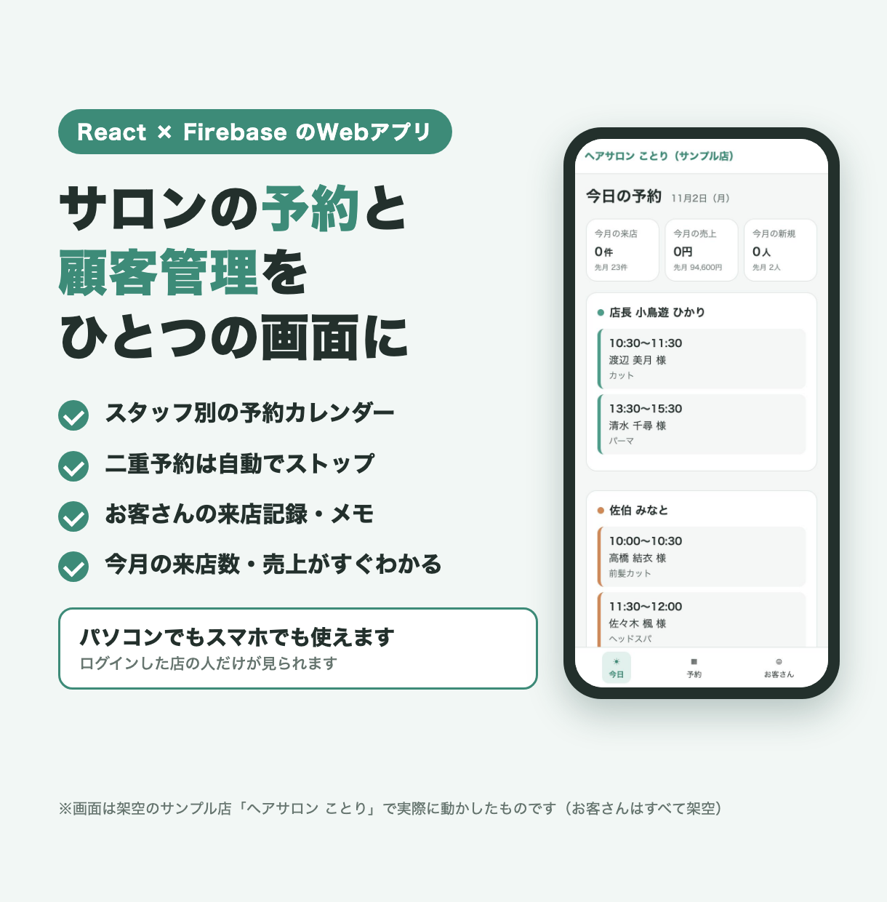
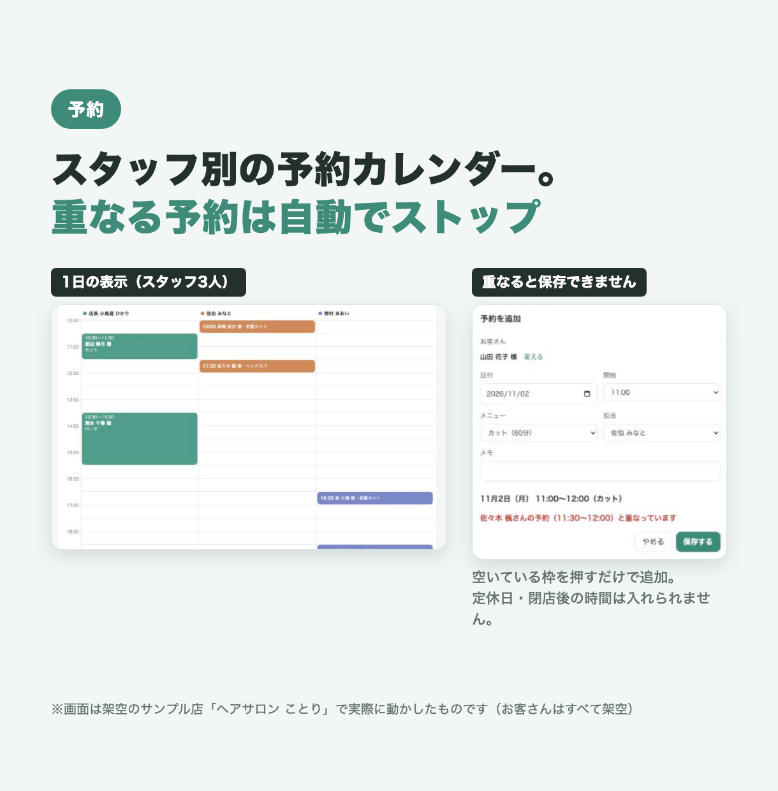
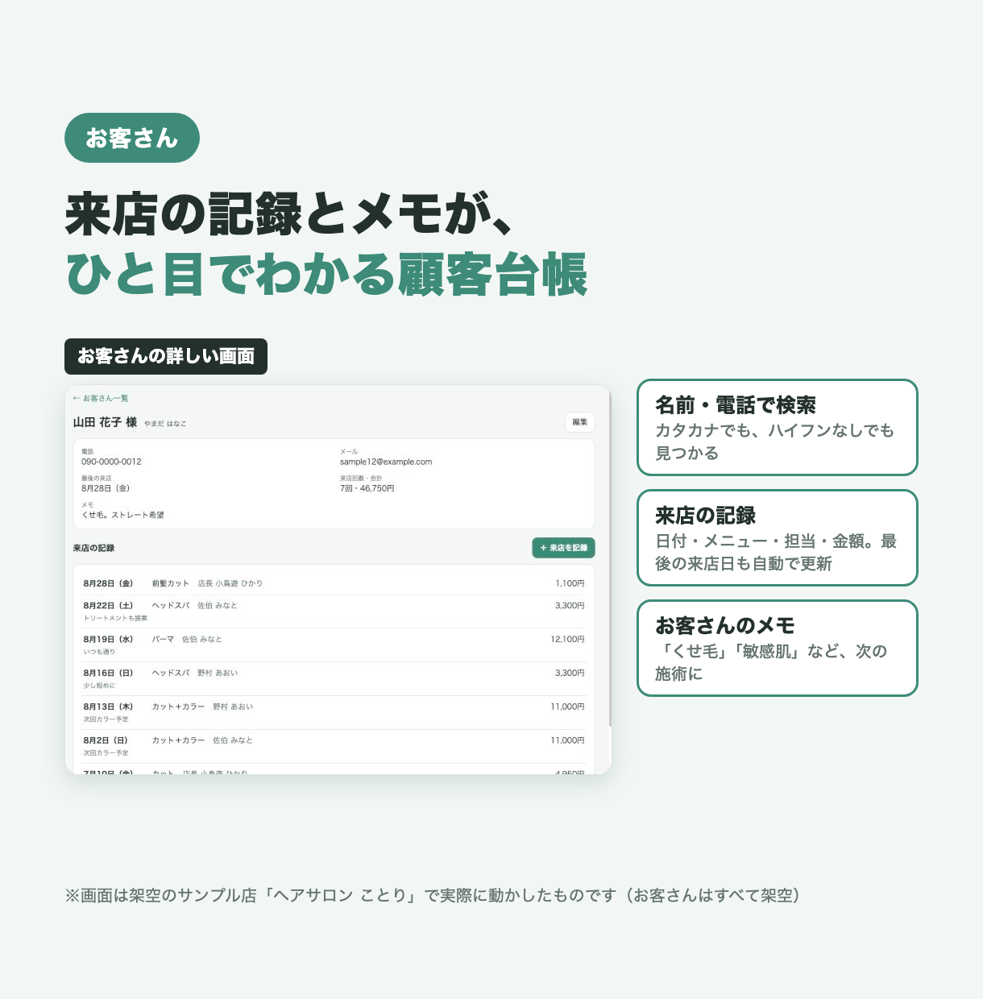

# 予約・顧客管理Webアプリ（架空のサンプル店「ヘアサロン ことり」の見本）

美容室・サロン向けの、予約と顧客管理をひとつにまとめた管理画面の見本です。
お店の名前・スタッフ・お客さん・予約は**すべて架空**で、実在のお店やお客さんとは関係ありません。

## できること
- **スタッフ別の予約カレンダー**：1日表示（スタッフ3人の列×30分の行）と週表示。空いているマスを押すと予約の追加、予約を押すと変更・取り消し
- **二重予約の防止**：同じスタッフで時間が重なる予約は保存できず、どの予約と重なっているかを表示します。定休日（火曜）や閉店後の時間も入れられません
- **顧客台帳**：名前・ふりがな・電話で検索（カタカナでも、ハイフンなしでも見つかる）。連絡先とメモの編集
- **来店の記録**：日付・メニュー・担当・金額を記録。最終来店日は自動で更新。未来の日付は記録できません
- **今月の数字**：今日の予約一覧と、今月（と先月）の来店数・売上・新規の人数
- **店の人だけが使える**：メールとパスワードでログイン。登録された店の人以外は、データを読むことも書くこともできません（Firestore のルールで守ります）
- パソコンでもスマホでも使えます

## 画面






※画面は、架空のサンプル店のデータをエミュレーター（練習用のFirebase）に入れて、実際に動かしたものです。`screens/shots/` に、元の画面の画像もあります。

## 使った技術
- React 19 ＋ TypeScript（Vite）
- React Router
- Firebase（Firestore・Authentication・Hosting）
- Firebase Local Emulator Suite（本物のFirebaseを使わずに、自分のパソコンで動かす・テストする）
- Vitest（自動テスト）、@firebase/rules-unit-testing（アクセスの決まりのテスト）

## フォルダ構成
```
06-salon-admin/
├── README.md                 この説明
├── 設置手順書.md              動かし方・本番への公開手順
├── src/
│   ├── pages/                画面（今日・予約カレンダー・お客さん一覧／詳しい画面・ログイン）
│   ├── components/           共通の部品（レイアウト・予約の入力フォーム）
│   ├── auth/                 ログインの状態と、店の人だけを通す仕組み
│   ├── data/                 Firestore の読み書き
│   ├── lib/                  時間・重なり・検索・集計・サンプルデータの計算（＋テスト）
│   ├── firebase.ts           Firebase の初期化（エミュレーターへの切り替えも）
│   └── types.ts              データの型、スタッフ・メニューの定義
├── tests/                    エミュレーターを使うテスト（アクセスの決まり・データの読み書き）
├── scripts/
│   ├── seed-emulator.ts      エミュレーターに見本のログインユーザーとサンプルデータを入れる
│   └── demo-user.example.json 見本のログイン情報のひな形（エミュレーター専用）
├── firestore.rules           データのアクセスの決まり（店の人だけ読み書きできる）
├── firebase.json / .firebaserc  Firebase の設定（エミュレーターのポートなど）
├── .env.example              本番の Firebase の設定のひな形
├── .env.emulator / .env.test エミュレーター用の設定（練習用の値だけ）
├── listing/                  紹介用の画像
└── screens/shots/            画面の画像
```

## テストの動かし方
Node.js 22.12 以上と npm が必要です。エミュレーターのテストには Java（21 以上）も必要です。

```bash
cd samples/06-salon-admin
npm ci                 # 必要なものを入れる
npm test               # 時間・重なり・検索・集計・サンプルデータのテスト（28件）
npm run test:emu       # エミュレーターを自動で起動して、アクセスの決まりとデータの読み書きをテスト（8件）
npm run build          # 型チェックと、公開用のファイルの作成（dist/ に出ます）
```

画面を動かして触ってみるときは：

```bash
cp scripts/demo-user.example.json scripts/demo-user.json
npm run emulators      # 練習用のFirebaseを起動（開いたまま）
# 別のウィンドウで
npm run seed           # サンプルデータを入れる
npm run dev:emu        # http://localhost:5173 を開き、demo-user.json のメールとパスワードでログイン
```

## 設置の流れ
自分のパソコンでの動かし方と、本物の Firebase に公開する手順は [設置手順書.md](設置手順書.md) にまとめています。

1. Firebase のプロジェクトを作り、メール／パスワードのログインと Firestore を有効にする
2. ウェブアプリの設定値を `.env.production` に書く
3. `npm run build` → `npx firebase deploy --only hosting,firestore`
4. お店の人のユーザーを `members` に登録する

## 注意
- 「ヘアサロン ことり」は架空のお店です。スタッフ・お客さん・予約・売上の数字は、すべて見本用に作ったものです（メールは example.com、電話は 090-0000-XXXX）。
- `.env.emulator` / `.env.test` / `scripts/demo-user.example.json` の値は、エミュレーターの中だけで使う練習用のものです。本物の Firebase の鍵やパスワードは入っていません。
- 本番で使うときの設定（`.env.production`）とログイン情報（`scripts/demo-user.json`）は `.gitignore` に入れてあり、リポジトリには含めません。
